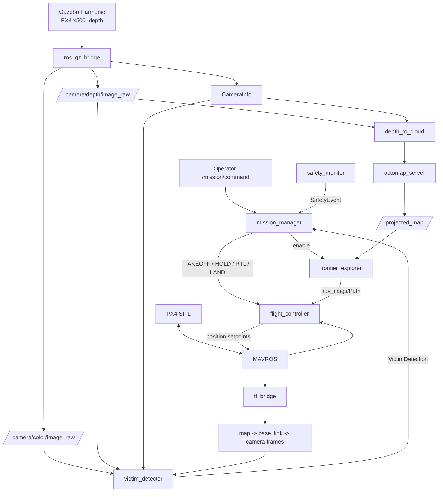

# ROS 2 Drone Search-and-Rescue Autonomy

A simulation-first autonomous aerial robotics project built around **PX4**, **ROS 2 Humble**, **Gazebo Harmonic**, **MAVROS**, **OctoMap**, and **YOLO**.

> Mission: **takeoff → autonomous exploration → 3-D mapping → victim-candidate detection → return/landing**

This repository is designed as an engineering portfolio project, not a flight-certified product. The default workflow is **SITL only**. Real-vehicle deployment requires independent safety review, hardware-specific configuration, manual takeover, geofencing, and staged flight testing.

## Why this version is different

The original prototype launched a PX4 vehicle and a second, separate URDF sensor model. That can visually look correct while the camera is not physically attached to the vehicle that PX4 is flying. This version instead uses PX4's native `gz_x500_depth` model, so the depth camera belongs to the **same simulated vehicle** as the flight dynamics.

The autonomy stack also has a single control owner: only `flight_controller` talks to PX4 arming/mode services and offboard setpoints. Mission, exploration, perception, and safety nodes request behavior through ROS topics rather than competing for actuator authority.

## Architecture



## Software baseline

| Component | Baseline |
|---|---|
| Ubuntu | 22.04 LTS |
| ROS 2 | Humble |
| PX4 | pinned Gazebo SITL snapshot `v1.17.0-alpha1-1551-g381149fb01` |
| Gazebo | Harmonic |
| MAVROS | ROS 2 branch / Humble binary |
| Vehicle | PX4 `gz_x500_depth` |
| Mapping | OctoMap projected 2-D occupancy + full 3-D octree |
| Detection | Ultralytics YOLO, default `yolov8n.pt` |

## Packages

```text
src/
├── drone_msgs/          custom mission, victim, and safety messages
├── drone_description/   RViz-only TF/visual model; never spawned as a second Gazebo vehicle
├── drone_control/       PX4/MAVROS offboard controller + map/base TF bridge
├── drone_perception/    depth→point-cloud, YOLO victim-candidate detection, safety monitor
├── drone_exploration/   2.5-D frontier extraction + obstacle inflation + A* planning
├── drone_mission/       high-level mission state machine
└── drone_bringup/       launch, configuration, RViz
```

## Docker quick start (recommended)

The project is Docker-first on Linux. You do **not** need to install ROS 2, PX4, Gazebo, MAVROS, OctoMap, or YOLO directly on the host. The host only needs Docker Engine + Docker Compose v2.

The Compose stack has two services:

- `px4`: official `px4io/px4-sitl-gazebo:v1.17.0-alpha1-1551-g381149fb01` running PX4 SITL + Gazebo Harmonic.
- `ros`: ROS 2 Humble development image containing MAVROS, `ros_gzharmonic`, OctoMap, RViz, OpenCV, Ultralytics, and this workspace.

Both use host networking so MAVLink UDP and Gazebo Transport discovery stay simple and deterministic on Linux.

> **Docker image note (validated 2026-10-19):** Docker Hub did not resolve the plain `px4io/px4-sitl-gazebo:v1.17.0` tag during runtime validation. This repository therefore pins the published snapshot `px4io/px4-sitl-gazebo:v1.17.0-alpha1-1551-g381149fb01`. The exact simulator version used for recorded results should always be reported.

### 1. Build the image and ROS workspace

```bash
./scripts/docker_build.sh
```

### 2. Start PX4/Gazebo and the ROS container

Headless simulation:

```bash
./scripts/docker_up.sh
```

With Gazebo GUI:

```bash
PX4_GUI=1 ./scripts/docker_up.sh
```

### 3. Launch the complete ROS autonomy stack

In another terminal:

```bash
./scripts/docker_launch.sh
```

### 4. Verify sensors and mapping before flight

```bash
./scripts/docker_shell.sh
```

Inside the container:

```bash
ros2 topic echo /mavros/state --once
ros2 topic hz /camera/color/image_raw
ros2 topic hz /camera/depth/image_raw
ros2 topic hz /camera/depth/points
ros2 topic echo /projected_map --once
```

### 5. Start the mission explicitly

```bash
./scripts/docker_start_mission.sh
```

The stack deliberately does **not** arm the drone simply because the containers started.

### 6. Stop

```bash
./scripts/docker_stop.sh
```

Full Docker details, reset instructions, RViz, environment overrides, and VS Code Dev Container usage are in [`docs/DOCKER.md`](docs/DOCKER.md).

## Native Ubuntu workflow (optional)

If you intentionally want a non-Docker setup, use Ubuntu 22.04 + ROS 2 Humble and install PX4 / Gazebo Harmonic on the host. The existing `install_deps.sh` remains available for that workflow. Docker is the recommended path for this repository because it keeps the host clean and pins the PX4 simulator image to `v1.17.0-alpha1-1551-g381149fb01`.

## Mission behavior

1. `mission_manager` waits for MAVROS/PX4 connectivity.
2. On `START`, `flight_controller` begins streaming a local-position hold setpoint before requesting OFFBOARD.
3. PX4 enters OFFBOARD, arms, and climbs to the configured exploration altitude.
4. `frontier_explorer` searches the OctoMap projected occupancy grid for free/unknown boundaries.
5. Occupied cells are inflated by the configured safety radius; A* plans a collision-aware 2-D path while the vehicle holds a fixed altitude.
6. `flight_controller` tracks the path as local ENU position setpoints.
7. `victim_detector` runs YOLO on RGB frames and uses synchronized depth plus TF to estimate a 3-D map position.
8. Spatial deduplication prevents the same person from becoming a new victim ID every video frame.
9. When exploration completes or the mission timeout is reached, the mission requests PX4 `AUTO.RTL`; PX4 handles return and landing.
10. Warning or critical battery/geofence/altitude events can pre-empt the mission through `safety_monitor` and request RTL or landing.

## Important design limits

- Exploration is **2.5-D**, not a full 3-D kinodynamic planner. It plans in XY over the projected OctoMap and holds a fixed Z altitude.
- Person detection is a **victim-candidate proxy**, not medical victim classification.
- The mapping pose comes from MAVROS/PX4 local position in the default simulation configuration. A VIO/SLAM estimator can later replace that source.
- The repository is intentionally simulation-first. Do not connect it to a real vehicle and fly without independent failsafes and staged validation.

## Validation commands

Static repository checks:

```bash
bash scripts/run_checks.sh
```

After a ROS build:

```bash
bash scripts/ros_smoke_check.sh
```

See [`docs/TEST_PLAN.md`](docs/TEST_PLAN.md) for the staged acceptance plan and [`docs/ARCHITECTURE.md`](docs/ARCHITECTURE.md) for design details.

## Suggested GitHub repository name

`ros2-drone-sar-autonomy`

Suggested description:

> Simulation-first autonomous SAR drone stack with PX4, ROS 2, Gazebo Harmonic, MAVROS, OctoMap, frontier exploration, A* planning, depth perception and YOLO victim-candidate detection.

Suggested topics:

`ros2`, `px4`, `gazebo`, `mavros`, `uav`, `drone`, `autonomous-drone`, `octomap`, `path-planning`, `computer-vision`, `yolo`, `robotics`, `search-and-rescue`

## License

MIT. PX4, MAVROS, Gazebo, Ultralytics and other dependencies retain their own licenses.

## Portfolio demo / LinkedIn

For a recruiter-facing recording, follow [`docs/DEMO_RECORDING.md`](docs/DEMO_RECORDING.md). It provides a 60–90 second shot list and the exact ROS evidence to show on screen.

You can also run:

```bash
./scripts/demo_evidence.sh
```

to print a compact Docker + MAVROS + sensor + mission-status evidence snapshot during testing.

See [`docs/LINKEDIN_RELEASE.md`](docs/LINKEDIN_RELEASE.md) for claims that are appropriate before and after end-to-end runtime validation.
